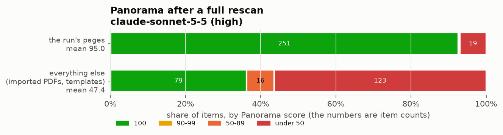

# Canvas accessibility toolkit

Scripts, skills and documentation for converting a Canvas course's
inaccessible PDFs and pages into accessible HTML that scores 100 in YuJa
Panorama (WCAG 2.1 AA), with an AI agent doing most of the work and the
instructor reviewing and publishing.

It came out of converting an upper-level physics lab course at Old Dominion
University in November 2026: 29.7% to 99.996% in Panorama, 249 items, with
12 transcribed lab guides and 48 converted vendor manuals. It is written so
that a smaller local model can run the pipeline (see
`docs/local-models.md`).

## What it does

- **Exports** an old course read only, and **triages** its documents
  (guide, manual, DOI link, drop).
- **Converts** vendor PDFs to Quarto drafts (`pdf2qmd.py`), with a gate that
  fails until the draft has been reviewed: alt text, math, headings, tables,
  links, lost text.
- **Renders** guides with accessible TikZ figures (required short alt text,
  visible long descriptions) and library-proxied DOI links.
- **Pushes** to Canvas as unpublished drafts, with locked uploads,
  accessibility fixes, a checklist run, and automatic splitting of long
  pages into linked parts. Pushes are git-like: an edit made in Canvas is
  merged back, never overwritten.
- **Builds modules** from a YAML list.
- **Reads YuJa Panorama** scores and issues, with no browser login.

## Safety by design

The rules an agent must follow are enforced in the Canvas client
(`scripts/canvas_api.py`), not just written down:

- It never publishes, unlocks, hides or shows anything, never sets the
  front page and never changes course settings. Those are the instructor's
  steps.
- It writes only to the one course named in `course.toml`. Source courses
  can only be read.
- It has no roster, grade or submission calls: student data never passes
  through it.
- The Panorama reader refuses any action that changes Panorama (Reprocess).

`tests/test_guard.py` checks each of these offline.

## Benchmarks

One-shot runs on the pilot course: the model gets one prompt and the
toolkit, with no instructor in the loop, and is scored against the
instructor-reviewed pilot output. Details and plots: `docs/benchmarks.md`.

| Run | Cost | Active time | Converted | Source words kept | Panorama, run's pages |
| --- | --- | --- | --- | --- | --- |
| Sonnet 5.5, high | $67.00 | 2 h 34 min | 59 of 60 | 0.97 guides, 0.965 manuals | 95.0 mean, 251 of 271 at 100 |
| Qwen 3.8 27B, local | $0 | running | | | |



## Quick start

Needs [uv](https://docs.astral.sh/uv/), [Quarto](https://quarto.org), a TeX
distribution with TikZ (for figures and PDFs), poppler (`pdftotext`,
`pdfimages`), and Node 22+ with Chrome or Chromium (for the Panorama reader).

```bash
T=~/teaching/canvas-a11y-toolkit/scripts
$T/new_course.py ~/teaching/phys101/spring2027 \
    --canvas-url https://canvas.example.edu --course-id 123456 --source 98765
cd ~/teaching/phys101/spring2027
# put CANVAS_TOKEN=... in .env, then:
$T/canvas.py whoami
$T/export_course.py
$T/triage.py
```

Then follow the pipeline in `AGENTS.md`, or point an agent at the
workspace: its `AGENTS.md` sends the agent here.

## Layout

```
AGENTS.md        rules and pipeline for agents (CLAUDE.md, QWEN.md link here)
skills/          one SKILL.md per pipeline step, with commands and checks
scripts/         the tools (run from inside a course workspace)
  canvas.py        push pages, syllabus, files, discussions; list; delete
  canvas_api.py    the guarded Canvas client
  canvas_sync.py   merge Canvas-side edits back (with html_merge, sync_state)
  export_course.py read-only export of a source course
  triage.py        measure every source document, record decisions
  pdf2qmd.py       PDF -> Quarto draft, and the review gate
  a11y_check.py    one rule per Panorama issue type
  page_parts.py    split long pages into linked parts
  modules.py       build modules from modules.yaml
  yuja.sh          read Panorama scores and issues
  new_course.py    make a course workspace
  config.py        find the workspace, read course.toml and .env
quarto/          Quarto filters: tikz.lua/tikz.py (figures), library-proxy.lua
templates/       files copied into a new workspace, and a guide skeleton
examples/        a finished example guide
docs/            the pipeline, Panorama playbook, Canvas HTML notes, local models, benchmarks
bench/           one-shot benchmark harness: prompt, runners, scoring, plots
tests/           offline tests: tests/run.sh
```

## A course workspace

```
course.toml      settings (committed)          .env       token (never committed)
modules.yaml     the module list               triage.csv decisions per document
guides/<id>/     transcribed guides + NOTES.md (committed)
manuals/<slug>/  converted vendor manuals (gitignored: copyrighted)
canvas/          hand-written site pages, sync state
source/          the exported old course (gitignored)
_notes/          Panorama dumps, upload scratch (gitignored)
tools ->         link to the toolkit's quarto/ filters
```

## Tests

```bash
tests/run.sh
```
