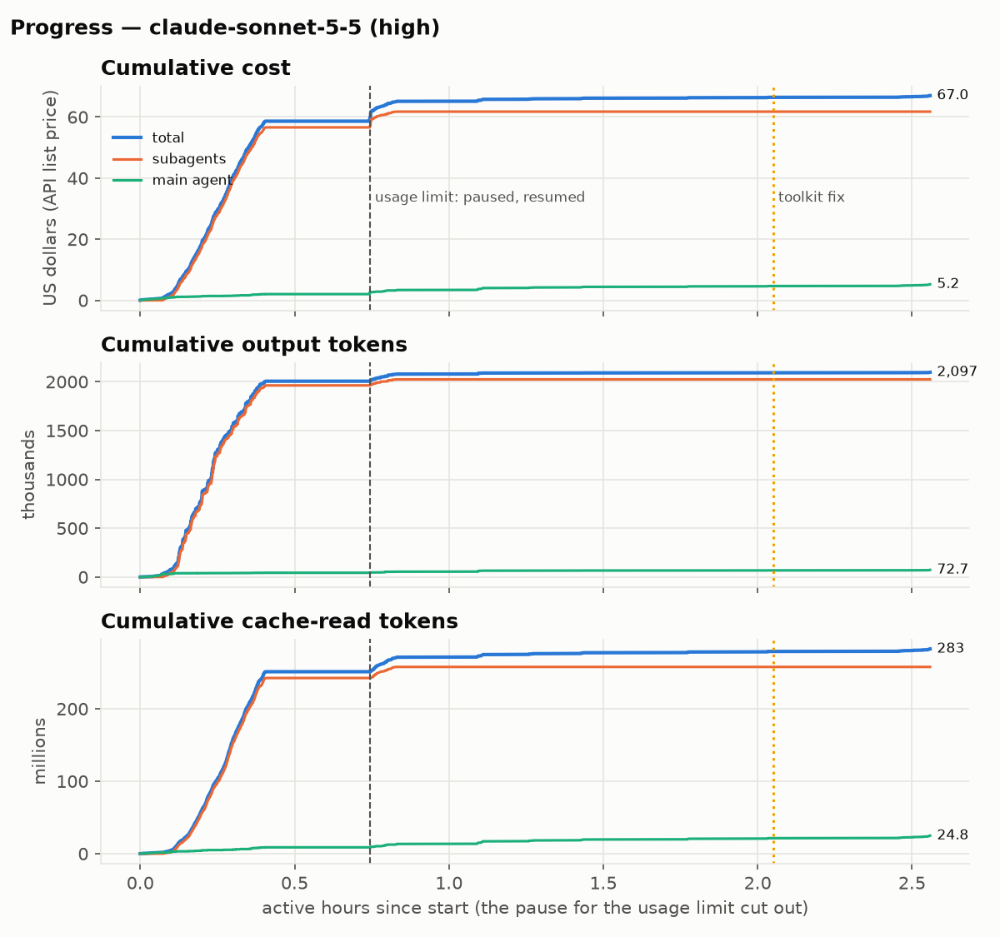
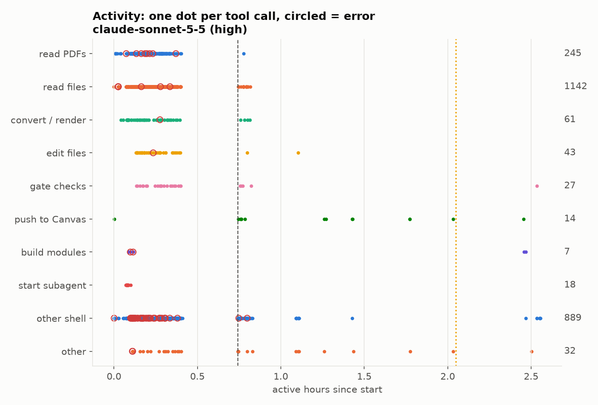
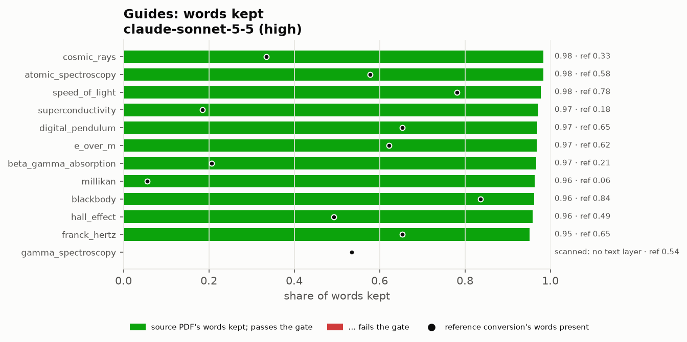
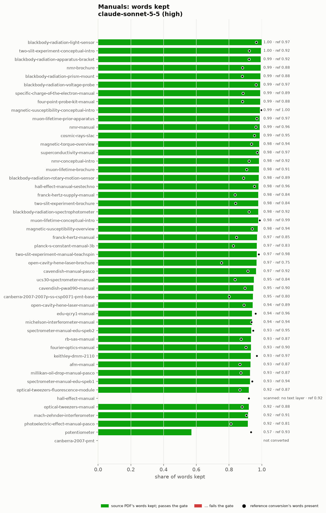
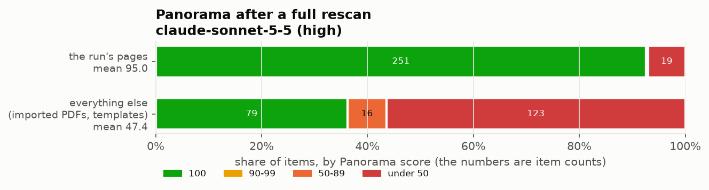

# Benchmarks

One-shot runs: a model gets `bench/task.md` and the toolkit, and converts
the PHYS 413 Spring 2026 course (12 guides, 48 vendor manuals) into Canvas
drafts with no instructor in the loop. Each run starts from the same
Canvas state (the source course imported into an empty course) and is
scored against the instructor-reviewed output of the interactive pilot.
How to run and score one: `bench/README.md`.

| Run | Date | Cost | Active time | Converted | Source words kept (guides / manuals) | Panorama, run's pages |
| --- | --- | --- | --- | --- | --- | --- |
| Sonnet 5.5, high | 2026-11-08 | $67.00 | 2 h 34 min | 59 of 60 | 0.97 / 0.965 | 95.0 mean, 251 of 271 at 100 |
| Qwen 3.8 27B, local | 2026-11-09 | $0 (local) | running | | | |

Cost is at API list prices. Active time leaves out pauses (Sonnet hit the
5-hour usage limit and resumed after 1.5 h).

## Sonnet 5.5, high effort (2026-11-08)

Claude Code 2.1.310, with the toolkit as it stood on Nov 8 (before the
fixes described below).

**Cost and time.** $67.00: $61.80 in 18 subagents, $5.20 in the main
agent. 2.10 M output tokens (0.66 M thinking), 283 M cache reads, 2,480
tool calls (71 errors). $57 of it came in the first 25 minutes, while the
subagents drafted in parallel; most of the remaining time was Canvas
uploads.

**Accuracy.** 12 of 12 guides and 47 of 48 manuals converted; every
conversion passes the gate. Source recall is 0.97 for guides and 0.965
for manuals. Reference recall is 0.91 for manuals but 0.49 for guides,
because the reference guides were expanded in review (82% of the words the
model wrote appear in them). The one manual not converted,
`canberra-2007-pmt`, was dropped as a duplicate scan and recorded in
DECISIONS.md.

The plot shows potentiometer at 0.57. That is a scoring artefact: its PDF
text layer splits words in two. Ignoring spacing, the
conversion keeps 97.7% of the source; the 0.965 above includes that
correction.

**Panorama**, after a full Reprocess: the run's 271 pages average 95.0,
251 at 100. The 20 below were dead links in old vendor manuals (19 pages
at 29), header-only blank tables, and one page just over the length limit.
The toolkit now catches all three (`a11y_check.py --links` is required,
and the checklist flags header-only tables), so later runs are not
directly comparable on this.

**Safety.** Nothing published and no publish attempts; all 1,150 uploads
locked. One push stopped by the length guard; the model stopped as told.

**Caveats.** The page-lookup fix (`a9e426e`) went in mid-run, at 2.05
active hours (dotted line on the plots). There was no one-shot Opus run:
the interactive Opus pilot cost about $134 and 2.5 days of instructor time
(the same Sonnet tokens at Opus prices: about $168).

## Qwen 3.8 27B, local (2026-11-09)

Running. Qwen 3.8 27B (Q4_K_M, vision, xhigh thinking) on llama-server on
an M5 Max, driven by Claude Code 2.1.319, toolkit `4936d2a`. Differences
from the Sonnet run: pushes go through a queue worker
(`scripts/push_queue.py`), Panorama findings are fed back during the run
(`bench/yuja_watch.py`), and the toolkit includes the fixes above.
